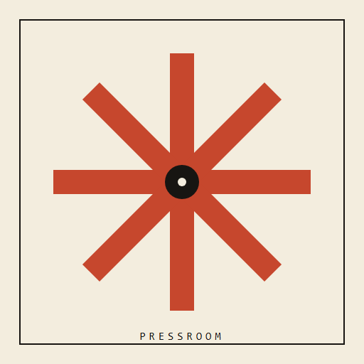
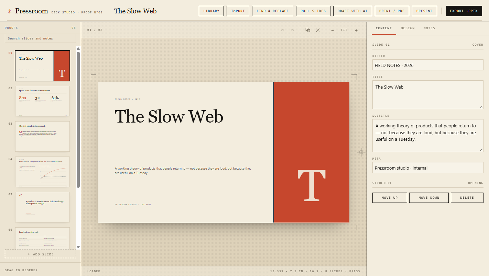
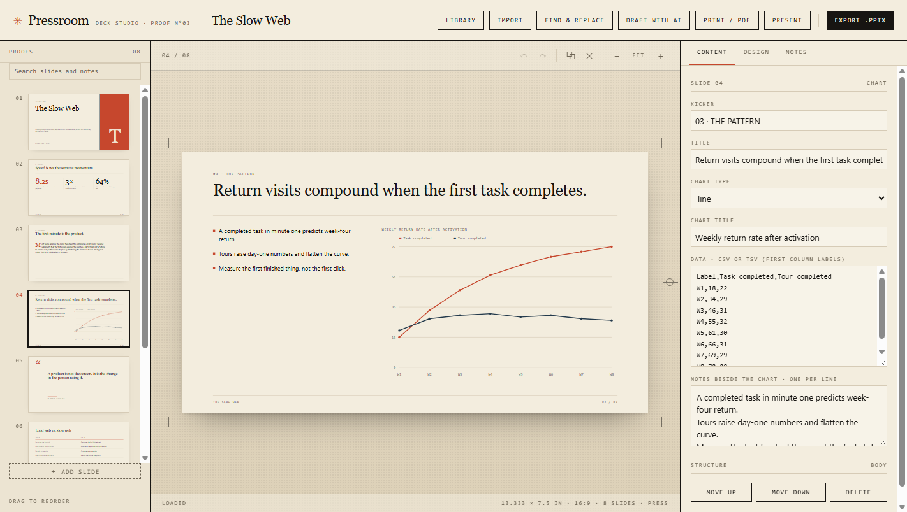
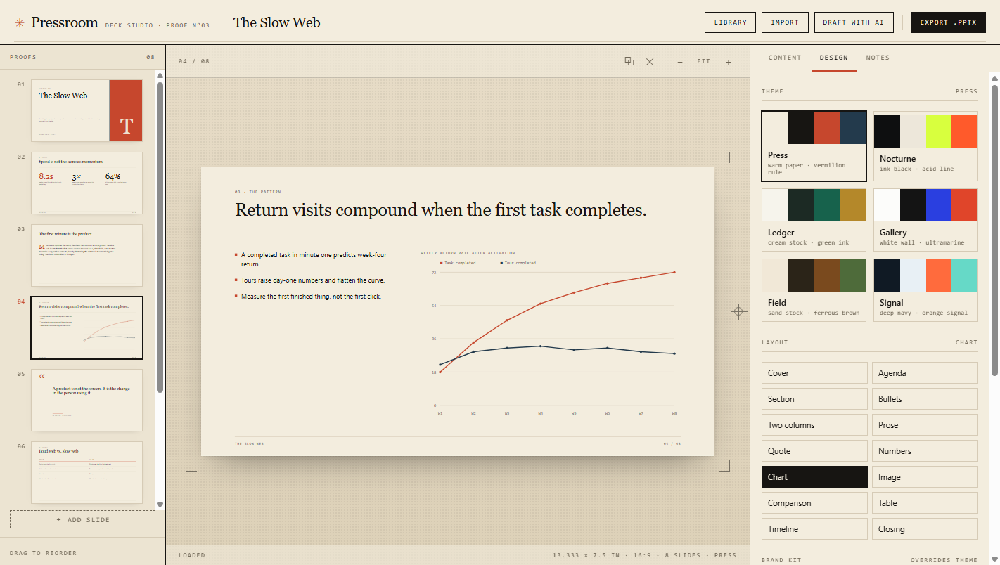
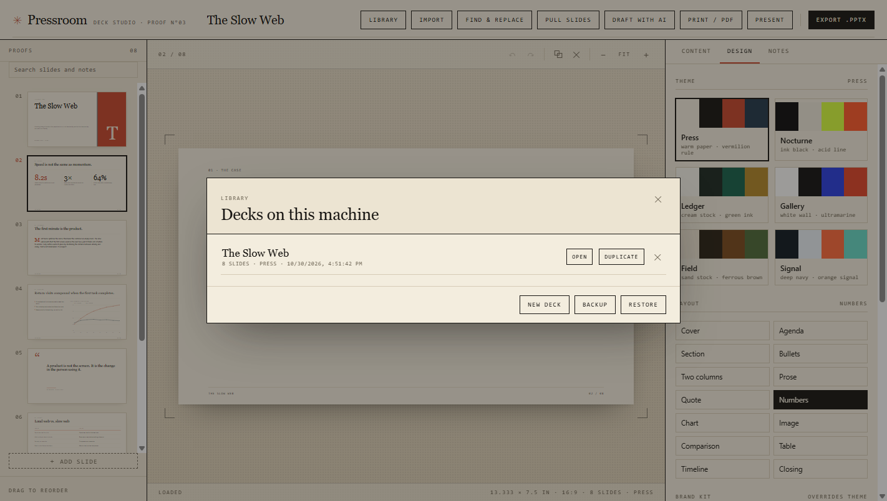
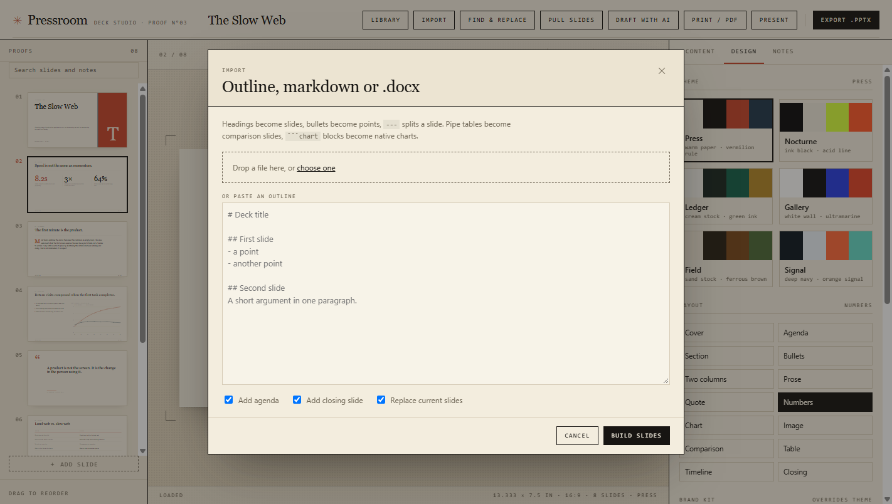
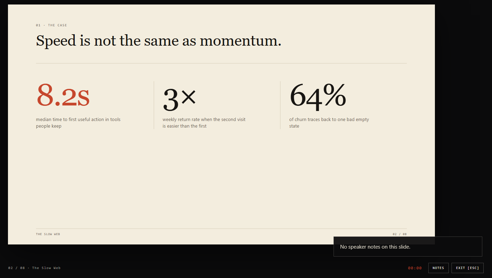

<div align="center">



# Pressroom

### Import an outline. Proof every slide. Export a deck that is still editable.

A local-first deck studio for Windows. Markdown or Word in, native PowerPoint out — real text,
shapes, charts, images and speaker notes, not pictures of slides.

[](https://github.com/KHHH2312/pressroom/releases/latest)
[](https://github.com/KHHH2312/pressroom/releases)
[](#requirements)
[](LICENSE)



</div>

> **New — 1.15.0** — a presenter time limit (amber at four fifths, red past the line), a blank screen in presenter view (B), a live next-slide preview, pull slides from another deck, and deck-wide find & replace.
> [Changelog →](CHANGELOG.md)

---

## Why Pressroom

**The output is a real deck.** Every title, bullet, table cell and chart is a native PowerPoint
object you can edit on another machine. Notes land in the notes pane. Brand colours and your logo
travel with the file.

**You proof the actual thing.** A live 13.333 × 7.5 in proof sits beside the inspector, with crop
marks, folio numbers and the same geometry the PPTX writer uses. No export roulette.

**It works offline.** The layout engine, themes, charts, image pipeline and PPTX writer need no
account and no model. Bring an OpenAI or Anthropic key only if you want a first draft.

**It behaves like a studio, not a form.** Slide rail with drag reordering, duplicate/delete,
undo and redo, keyboard navigation, autosave to disk, and a library for every deck you make.

## Features

| | |
|---|---|
| **Fourteen layouts** | Cover, agenda, section, bullets, two columns, prose, quote, numbers, chart, image, comparison, table, timeline, closing. Switch layout without losing text. |
| **Six themes** | Press, Nocturne, Ledger, Gallery, Field, Signal — paper/ink/accent systems with Windows-safe display and body families. |
| **Brand kit** | Accent, ink and paper overrides, footer line and logo. The logo is placed on every slide in the proof and the export. |
| **Native charts** | Bar, line, pie and donut from pasted CSV/TSV or JSON. PowerPoint charts, not screenshots. |
| **Images that stay put** | PNG/JPEG/WebP upload, full-bleed cover crop, alt text and caption. Embedded, never fetched from a URL. |
| **Speaker notes** | Per-slide notes editor; exported to the PowerPoint notes pane. |
| **Presenter view** | Elapsed timer with an optional time limit (amber at four fifths, red past it), speaker notes, a live next-slide preview and a blank screen — press B to black out the projection without leaving the podium. |
| **Import** | Markdown/text pasted or dropped, `.md`/`.txt`, `.docx` text extraction. Optional agenda and closing. |
| **Library** | Disk-backed decks, autosave, duplicate, delete. Nothing leaves the machine. |
| **AI draft (optional)** | Use your own OpenAI/Anthropic key. The key stays in the app's browser storage; no key is stored on a server. |
| **Portable** | Unzip, run `Pressroom.exe`. No installer, no admin rights, no telemetry. |

<div align="center">





</div>

## Requirements

- Windows 10 or 11, x64
- PowerPoint, Keynote or LibreOffice to open exported `.pptx` files
- No account, no runtime install

## Install

1. Download **Pressroom-1.15.0-win32-x64.zip** from
   [Releases](https://github.com/KHHH2312/pressroom/releases/latest).
2. Verify it against `SHA256SUMS.txt` on the same release:
   ```powershell
   Get-FileHash .\Pressroom-*-win32-x64.zip -Algorithm SHA256
   ```
3. `FILEMANIFEST.txt` lists the SHA-256 and size of every file in the archive — diff it against
   what you unpack.
4. Unzip anywhere and run **Pressroom.exe**.

> The build is code-signed with a self-signed development certificate. SmartScreen will still show
> an unknown publisher until an OV/EV certificate is used; the SHA-256 checksum is the trust anchor.

## Using it

1. The app opens with a sample deck. Replace it from **Library → New deck**, or press **Import**
   and paste an outline.
2. Pick layouts and a theme in **Design**. Add the brand colours and a logo if you have one.
3. Edit text, bullets, charts or tables in **Content**; put what you will say in **Notes**.
4. Press **Export .pptx**. The proof and the file share one geometry model.
6. Press **Present** for a full-screen run with an elapsed timer, the arrow keys and N for notes.
7. **Notes → Download script** writes every slide number, title and note as a .txt file.
5. `Ctrl+S` saves now, `Ctrl+E` exports, `Ctrl+Z` undoes, `Ctrl+Shift+Z` or `Ctrl+Y` redoes, arrow
   keys move between slides, drag the rail to reorder.

### Markdown that becomes slides

````markdown
# Deck title

## First slide
- A point
- Another point

## 42% | faster reviews
- 42% | faster reviews
- 3x | fewer retries

## Comparison
| Before | After |
| --- | --- |
| Slow | Fast |

## Data
```chart line
Label,North,South
Q1,10,8
Q2,14,11
```
````

`#` is the deck title, a second `#` is a section divider, `##` starts a slide. `value | label`
bullets become a Numbers slide; pipe tables become comparisons; `chart` fences become native
charts. Optional agenda and closing are generated on import.

## Verified

- Release pipeline test suite: **32 checks**, covering markdown parsing, layout selection, chart
  parsing, deck-wide text replacement, image-source safety, and PPTX structure (slides, notes, chart
  part, real text).
- Generated sample deck audited with a presentation geometry checker: **8/8 pages, zero issues**.
- Browser check: **32 checks** — rail search, find & replace with undo, pull slides from another deck, add, undo, redo, build the
  print set, present with the timer and notes, then download the speaker script, with no console errors.
- Earlier browser proof: editing, theme switching, slide add/delete/reorder, notes persistence,
  library duplicate/delete, `.docx` import and PPTX export were exercised end to end.
- Every release is built through an integrity gate: the packaged app must be byte-identical to
  source, contain no stray scripts, and carry no private data before it can be published.
- See [FILEMANIFEST.txt](FILEMANIFEST.txt) for the exact file list of the current archive.

## Security and privacy

- **Local only.** The embedded server binds to `127.0.0.1`; there is no remote surface, no
  telemetry and no update phone-home.
- **Strict renderer policy.** CSP with no remote scripts or images; the renderer is sandboxed with
  context isolation; navigation and window-open are denied.
- **Images are local data.** Only PNG/JPEG/WebP data URLs are accepted; imported markdown cannot
  make the app fetch a remote URL.
- **Keys stay in the app.** The AI key lives in this app's browser storage, is sent only to the
  provider you choose when you press Draft, and is never written server-side.
- **Signed releases, checksums, manifest.** See `SHA256SUMS.txt` and `FILEMANIFEST.txt`.
- Found a flaw? Open a private security advisory rather than a public issue.

## FAQ

**Does it upload my deck?** No. Decks are JSON on disk on your machine; the only outbound call is
an optional AI draft using your own key.

**Can I edit the exported file?** Yes — native shapes, text, charts and notes.

**Does it support PDF import?** Not in 1.0. Markdown, text and `.docx` text extraction are supported.

**Are animations exported?** No. Layouts, charts, images, notes and alt text are.

**Why is the source not in this repository?** This repository distributes the application and its
documentation. The source is private.

## License

MIT — see [LICENSE](LICENSE). Third-party components in [THIRD-PARTY.md](THIRD-PARTY.md).
“PowerPoint” is a trademark of Microsoft Corporation. Not affiliated with Microsoft, OpenAI or
Anthropic.

---

## The rest of the desk

Five local-first tools, one philosophy: your files, your machine, no telemetry.

- **Pressroom** — [deck studio](https://github.com/KHHH2312/pressroom)
- **Folio** — [PDF bindery](https://github.com/KHHH2312/folio)
- **Relay** — [API client](https://github.com/KHHH2312/relay)
- **Slate** — [markdown notebook](https://github.com/KHHH2312/slate)
- **Boardroom** — [whiteboard](https://github.com/KHHH2312/boardroom)
